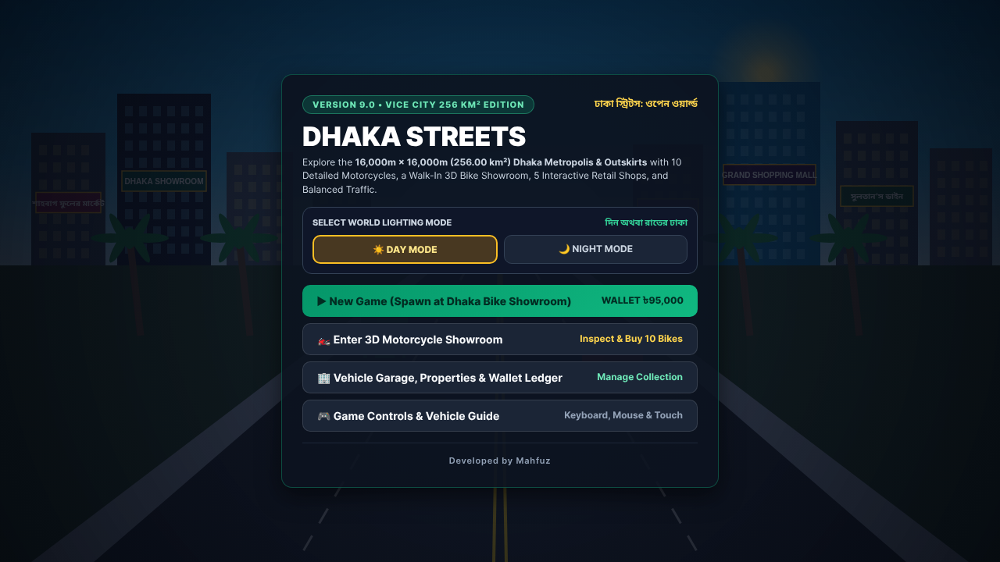
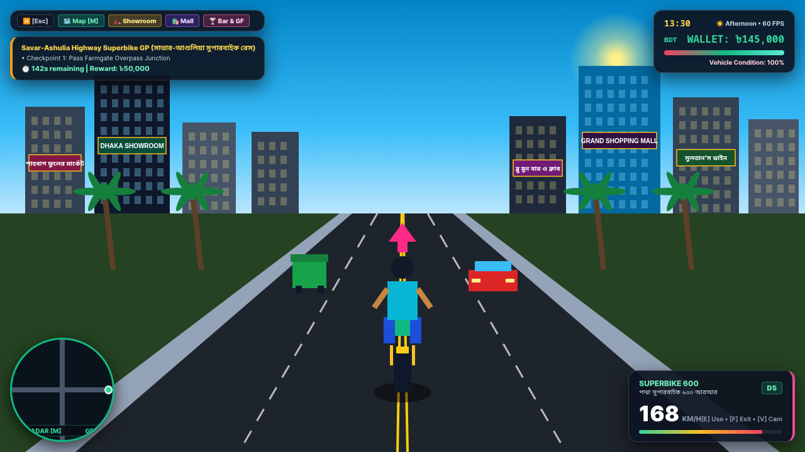
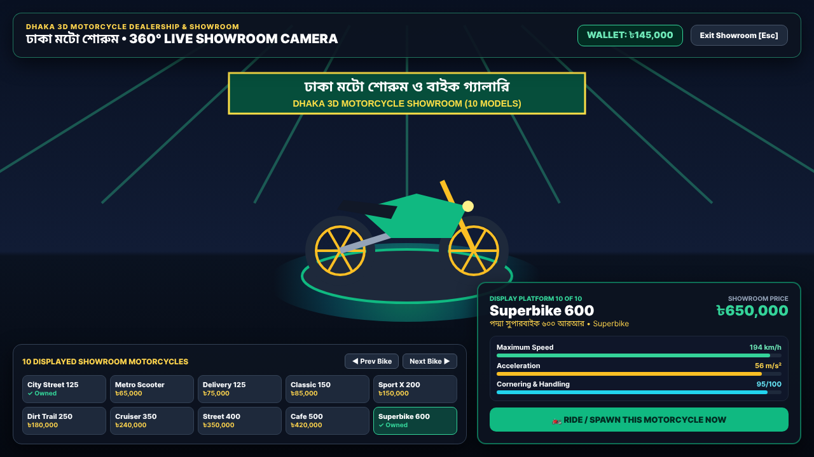

# 🏍️ Dhaka Streets: Open World (ঢাকা স্ট্রিটস: ওপেন ওয়ার্ল্ড)

**Developed by Mahfuz**

A browser-based 3D open-world action, driving, motorcycle showroom, and exploration game set in **Dhaka, Bangladesh**, built with **HTML5, CSS3, JavaScript (ES6+), Three.js (WebGL), and Web Audio API**.

---

## 📸 Game Screenshots

### 1. Main Menu & World Lighting Selector (`Day / Night Mode`)


### 2. Open-World Dhaka Street Driving, Radar GPS & Speedometer HUD


### 3. Walk-In 3D Motorcycle Showroom (10 Inspectable & Purchasable Bikes)


---

## ✨ Key Features

- **Colossal Open-World Dhaka Map:** Explore connected districts including **Shahbagh, Dhanmondi Lake, Hatirjheel Rainbow Bridges, Gulshan-2, Banani Road 11, Farmgate Overbridge, Motijheel, Old Dhaka (Puran Dhaka), Lalbagh Fort, Ahsan Manzil, Sadarghat Launch Terminal, Uttara, Mirpur Stadium, Purbachal 300ft Expressway, and Padma Southern Expressway**.
- **Walk-In 3D Motorcycle Showroom:** Inspect and purchase **10 distinct 3D motorcycles** (*City Street 125, Metro Scooter 110, Delivery Scooter 125, Classic Rider 150, Sport X 200, Dirt Trail 250, Buriganga Cruiser 350, Premium Sport 400, Retro Bengal Cafe 500, and Superbike 600*) with live 360° camera orbit.
- **21 Driveable Vehicles & Boats:** Ride motorcycles with realistic cornering lean physics, drive luxury sports cars (*BMW M4, Mercedes-Benz AMG, Audi R8*), Dhaka buses, painted trucks, CNG auto-rickshaws, cycle rickshaws, and Hatirjheel speed boats.
- **5 Interactive Retail Shops & VIP Lounge:** Visit clothing boutiques, convenience stores, bike gear shops, auto customs garages, and the Blue Moon Bar & Lounge.
- **60 FPS Performance Optimized:** Built with spatial hash-grid collision detection (`O(1)`), shared WebGL geometry/material pools, chunk streaming, and distance LOD culling for smooth browser performance.

---

## 🚀 How to Push to GitHub & Deploy on Netlify

### Step 1: Push to GitHub
Unzip the project folder, open a terminal inside the project directory, and run:

```bash
git init
git add .
git commit -m "Initial commit: Dhaka Streets Open World by Mahfuz"
git branch -M main
git remote add origin https://github.com/<your-username>/<your-repo-name>.git
git push -u origin main
```

### Step 2: Deploy to Netlify (2 Easy Ways)
1. **Via GitHub Integration (Recommended):**
   - Log in to [Netlify](https://app.netlify.com/) and click **Add new site → Import an existing project → GitHub**.
   - Select your repository.
   - Netlify will automatically detect `netlify.toml` (`Publish directory: .`, `Build command: (empty)`).
   - Click **Deploy site** — your game will be live in seconds!
2. **Via Netlify Drag & Drop:**
   - Drag and drop the unzipped project folder directly onto [app.netlify.com/drop](https://app.netlify.com/drop).

---

## 💻 Local Development

You can run the project locally using any static server or Vite:

```bash
# Option A: Using Vite Dev Server
npm install
npm run dev

# Option B: Open the standalone single-file build directly in any browser
# Double-click dhaka_streets_open_world.html
```

---

## 🎮 Controls Guide

| Key / Input | Action |
| :--- | :--- |
| **W, A, S, D / Arrow Keys** | Move (On Foot) / Accelerate, Brake & Steer (Vehicle) |
| **Shift** | Sprint (On Foot) |
| **Space** | Jump (On Foot) / Handbrake Drift (Vehicle) |
| **E** | View Showroom Bike / Enter Shop / Enter Nearby Vehicle / Start Mission |
| **F** | Exit Vehicle / Stand Up from VIP Table |
| **G / O** | Open Garage Collection, Real Estate Empire & Wallet Ledger |
| **M** | Open Interactive Full City Map, GPS Pin & Fast Travel |
| **N / T** | Toggle Day / Night Mode & Cycle Morning / Afternoon / Sunset |
| **H / L** | Honk Horn / Toggle Vehicle Headlights |
| **P** | Snap Landmark Photo |
| **Mouse Drag** | 360° Third-Person Orbit Camera |
| **Esc** | Pause Menu & Settings |

---

© **Developed by Mahfuz** — *Dhaka Streets: Open World*
